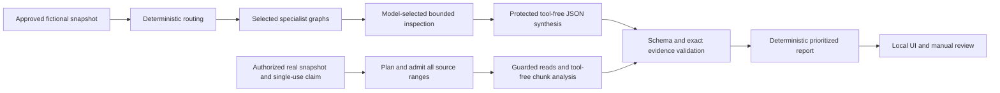

# Northstar CodeReview

Northstar CodeReview is a local code-review prototype with five LangGraph
specialists, bounded source-inspection tools, evidence-backed findings, and a
Streamlit interface. It supports fictional Python, Java, TypeScript, Kubernetes,
GitOps, and Jenkins/Groovy review scenarios.

It is intended for developers and platform engineers exploring bounded,
human-reviewed code analysis on a single-user workstation.

The demonstration inputs are fictional; a separate real-code workflow accepts
three explicitly authorized local sample groups. The application does not
execute reviewed code, retrieve GitHub pull requests, or publish review comments.
It is not production-ready. The public release scope excludes private snapshots,
credentials and runtime records. See [publication scope](docs/publication-scope.md).

## License

Licensed under the MIT License. See [LICENSE](LICENSE).

## What is implemented

- Code Quality, Security, Test Coverage, GitOps Platform, and CI/CD & Groovy specialists.
- Deterministic routing and isolated parallel LangGraph execution.
- Immutable, hashed source snapshots and four read-only LangChain inspection tools.
- Fixed-allowlist real-source intake, explicit retention replacement, and independent
  import/transmission receipts. A guarded runner and Streamlit workflow support
  one Code Quality specialist per real sample; integration tests use generated data.
- Deterministic complete-plan admission and bounded chunk analysis for authorized
  real Code Quality reviews. Prepared and validated analyzed coverage are separate.
  Fictional scripted reviews retain their model-directed inspection path.
- Explicit `standard`, `extended_csv`, and `extended_bm25` profiles, bound to
  transmission approval and a durable single-use execution claim; no automatic escalation.
- Atomic shared request, tool, token-reservation, and deadline admission.
- Owner-bound synthesis request reservations; the isolated GitOps runner also
  protects synthesis input capacity within its existing total budget.
- Nebius Token Factory integration with synthesis-only JSON-object mode.
- Compact observed-range citations in prepared synthesis, resolved into the existing
  Pydantic proposal and exact-source evidence validators.
- Prioritized sanitized JSON/Markdown reports and local SQLite human-review checkpoints.
- Scripted integration evaluation, saved live-result viewing, and a local Streamlit UI.

**Evidence validity does not prove defect correctness.** A finding remains an
unverified claim even when its exact source quotation passes validation. Model
confidence is not calibrated correctness or approval authority.

## Local setup

Use a supported POSIX workstation, an existing uv-managed Python 3.12 installation,
and a complete checkout. The verified interpreter is Python 3.12.15. Intake relies
on POSIX descriptor protections and the editable `src/` layout; Windows and
standalone wheel deployment are not verified.

Run from the checkout root. Dependency downloads require the operator's approval;
this command reproduces the locked environment without downloading Python:

```sh
mkdir -p .cache/tmp
PYTHONDONTWRITEBYTECODE=1 TMPDIR="$PWD/.cache/tmp" \
  uv sync --locked --python 3.12 --managed-python --no-python-downloads \
  --no-config --cache-dir "$PWD/.cache/uv" \
  --default-index https://pypi.org/simple --keyring-provider disabled --no-sources
```

When the required distributions are already cached, add `--offline` to avoid
package-network access. No global Python, shell, PATH, or Git configuration is
needed. `.venv`, caches, runtime results, and local secrets are excluded from the
proposed publication snapshot.

`pyproject.toml` declares runtime imports explicitly: Pydantic, LangGraph,
LangChain Core/OpenAI, Streamlit, HTTPX, OpenAI SDK, and LangSmith. LangSmith is
used to disable tracing explicitly, not to authorize a remote tracing session.
`uv.lock` is the exact dependency record. The verified lock includes Pydantic
2.14.2, LangGraph 1.2.19, LangChain Core/OpenAI 1.7.3, Streamlit 1.66.1, HTTPX
0.28.1, OpenAI SDK 3.42.0, and LangSmith 0.14.16. pytest is a development dependency;
`uv_build` builds the local package. Dependency updates require regression testing.

## Run the local application

No credentials or `.env` loading are needed for scripted or saved-result viewing:

```sh
env PYTHONDONTWRITEBYTECODE=1 \
  LANGSMITH_TRACING=false LANGCHAIN_TRACING_V2=false \
  TMPDIR="$PWD/.cache/tmp" \
  .venv/bin/python -B examples/local_app.py start
```

Project configuration binds to `127.0.0.1`, disables usage statistics and file
watching, preserves CORS/XSRF protections, and suppresses raw error details.
Do not expose this unauthenticated application through a public listener or tunnel.

In **Test Lab**, choose Java, Angular, or Jenkins-on-AKS for a **scripted integration** review
or view compatible saved live artifacts. Saved results are local optional data;
a fresh checkout will not contain the ignored live artifacts.

Choose **New Review** for Portfolio Risk, CSV Import, or BM25 Retrieval.
Select a previously imported snapshot, inspect scope and retention, explicitly
choose an execution profile and authorize transmission, then separately start one bounded live review. Selection
and reruns never start inference. Credentials are read only on the start action;
missing configuration blocks execution. No publication action exists. See the
[real-source workflow guide](docs/real-source-intake.md#local-real-review-workflow)
for explicit environment loading, CLI commands, retention and export.

Findings show severity, uncalibrated confidence, specialist attribution, source
locations, evidence status, unverified claim status, and remediation. The Java
scripted baseline deliberately includes an incorrect finding. Its test-case label
comes from report-bound fixture judgments, never arbitrary model wording.

“Start human review” creates a local checkpoint. Approve, Reject, and Request
changes record a manual decision against the exact report revision/hash. Partial
reviews require acknowledgment. The local operator identity is not authenticated
production authorization, and these decisions grant no external publication rights.

## Offline verification and demonstration

```sh
env PYTHONDONTWRITEBYTECODE=1 \
  LANGSMITH_TRACING=false LANGCHAIN_TRACING_V2=false \
  TMPDIR="$PWD/.cache/tmp" \
  .venv/bin/python -B -m pytest -q --basetemp=.runtime/pytest-tmp
```

Most recent verified full offline baseline (2026-11-09): **2,278 tests passed**,
with no reported failures, skips or warnings. This is application verification,
not model accuracy.

Tests use synthetic fixtures, fake models, real graph/tool workflows, in-memory
HTTP transports, and Streamlit AppTest. The suite blocks socket connections and
DNS calls during tests. The command places test temporary files under ignored
`.runtime/pytest-tmp` so approval databases satisfy the application’s runtime-only
storage boundary; pytest caches stay under `.cache`. Use this dedicated test
directory only: pytest clears its base temporary directory before a run. The
default `.cache` base directory does not satisfy the approval UI tests’ storage
contract. Tests do not require credentials or
execute the reviewed Java, TypeScript, Python, Groovy, or Kubernetes source.

To run the scripted evaluation harness separately:

```sh
env PYTHONDONTWRITEBYTECODE=1 \
  LANGSMITH_TRACING=false LANGCHAIN_TRACING_V2=false \
  TMPDIR="$PWD/.cache/tmp" \
  .venv/bin/python -B examples/evaluate_offline.py
```

It uses the existing graphs and writes sanitized JSON/Markdown under ignored
`.runtime/evaluation`. Scripted results demonstrate application wiring and
validation behavior, not independent model accuracy. The three fictional
scenarios are not three real pull-request evaluations.

## Live evaluation status

The configured runtime model is `Qwen/Qwen3-30B-A3B-Instruct-2507` on Nebius Token
Factory. Controlled live evaluations have demonstrated model-selected tool calling,
tool-result replay, and structured JSON synthesis. Java, Angular, and
Jenkins-on-AKS full live reviews remained **partial**. The isolated GitOps review
reached structured proposal validation but failed exact-source evidence validation.
**No retained evidence-validated live finding has yet been established.**

The real Code Quality path has been evaluated on three approved local sample
groups. The results below distinguish historical preparation from the current
chunk engine's validated unit-analysis metric:

| Sample / execution | Status | Prepared lines | Validated analyzed lines | Model requests | Result |
|---|---|---:|---:|---:|---|
| Portfolio Risk, prepared-source | Completed | 138/138 | Not separately recorded | 1 | Valid empty findings |
| CSV Import, original | Partial | 213/541 | Not separately recorded | 2 | Truncation; envelope rejected |
| CSV Import, first extended | Partial | 541/541 | 0/541 | 3 | Three insufficient-evidence outcomes |
| CSV Import, corrected prompts | Completed | 541/541 | 541/541 | 3 | Three valid empty findings outcomes |
| BM25 Retrieval, original | Partial | 159/540 | Not separately recorded | 2 | Truncation; envelope rejected |

Only Code Quality ran, with zero retries and repairs. No live source-code defect
has been validated. The corrected CSV run completed nine source reads in 4.01
seconds with no truncation; finding-level citation validation was not exercised
because no findings were proposed. BM25 has not been evaluated live with its new
extended profile and corrected prompts. Completion does not prove defect absence,
independent accuracy or general reliability. These were not public PR evaluations.
See the [evaluation report](docs/evaluation-report.md) and the
[saved-review interface guide](docs/product-interface.md#saved-review-walkthrough).
Private source, approvals and runtime results are not included in a fresh checkout.

Earlier Java evaluations used a trusted Code Quality skill containing a similar
refund example. That example has since been removed; the historical results remain
affected by that overlap.
It is a workflow/protocol scenario, not an independent accuracy benchmark.
Incomplete reviews cannot establish clean negative controls. Source-line overlap
alone never establishes a true positive; semantic judgment is a separate gate.

## Explicit live configuration

The UI and ordinary imports never read `.env`. Optional generic settings use
`NORTHSTAR_LLM_PROVIDER` and `NORTHSTAR_LLM_MODEL`. Nebius runners use explicit
`NEBIUS_API_KEY`, `NEBIUS_MODEL`, and the official `NEBIUS_BASE_URL`. `.env.example`
contains blank credential/model placeholders. If creating a local `.env`, keep it
owner-only (`0600`) and excluded from publication. Never put credentials in command
arguments, logs, screenshots, or committed files.

Fictional live runners require pinned inputs and `--allow-live`. The real-source
runner additionally requires a retained verified import and a current exact-snapshot
transmission receipt bound to the exact profile and specialist, consumed by a
durable single-use claim before provider construction. All require the configured model and separate operator
approval. They use zero provider retries and output
repairs. `uv --offline` prevents package downloads; it does not disable inference
HTTPS once a runner is explicitly authorized. Do not run a live example as a
routine installation or test step.

See [evaluation](docs/evaluation.md), [GitOps slice](docs/gitops-slice.md), and
[structured-output probe](docs/structured-output-probe.md) for bounded interfaces.
No live operation is authorized by this documentation.

## Architecture and boundaries



Reports record selected and skipped specialists; the developer workspace displays
all five specialist capabilities with distinct selection and recorded execution
statuses. Missing execution metadata remains unavailable.
Real reviews execute an admitted deterministic chunk plan. Completion, prepared
and analyzed coverage, recovered errors,
valid synthesis, validated evidence, and defect correctness are separate outcomes.
The report schema is **4**, full live-evaluation envelope **3**, and semantic
evaluation-result envelope **2**. The isolated GitOps envelope is **1**. Older
incompatible artifacts are withheld rather than silently migrated.

- [Architecture and contracts](docs/architecture.md): source, tools, graph, budgets, reporting, approval.
- [Security boundaries](docs/security.md): provider limits, output safety, local storage and threat assumptions.
- [Real-source intake](docs/real-source-intake.md): fixed future sample scope, privacy checks, private storage and separate authorization.
- [Evaluation methodology and results](docs/evaluation.md): provenance, human judgments and live limitations.
- [Reserved synthesis](docs/synthesis-gate.md): final-output schema, replay and diagnostic contracts.
- [Streamlit application](docs/streamlit-application.md): presentation, local review and deferred integration boundaries.
- [Publication scope](docs/publication-scope.md): licensing status and maintainer review requirements.

GitHub ingestion and diff-anchored comment publication are not implemented.
Regex search, sandboxed scanners, cross-review memory, authenticated multi-user
approval, arbitrary-source redaction, and verified monetary cost middleware remain
deferred. Pattern filtering and hashes do not establish universal secrecy,
authenticity, or correctness. Scripted integration and limited live real-source
results do not establish independent accuracy. Original-source import and external transmission require separate human
approvals. Local report approval does not establish defect correctness or rights.

## Prepared-source engine evaluation

Authorized real reviews now prepare bounded source observations before inference.
The five specialist identities and outer LangGraph router remain unchanged; the
real-source CLI and UI still authorize Code Quality only. The model returns concise
claims and observed-range pointers, while deterministic code resolves exact source
quotations and validates them. See [engine design](docs/review-engine-design.md).

Run the fixed offline matrix with the existing environment:

```sh
PYTHONDONTWRITEBYTECODE=1 TMPDIR="$PWD/.cache/tmp" \
  LANGSMITH_TRACING=false LANGCHAIN_TRACING_V2=false \
  .venv/bin/python -B examples/evaluate_review_engine.py
```

This uses scripted responses, actual graph nodes and local tools, generated
snapshots, and an existing fictional negative control. It makes no provider calls
and writes no results. Its controlled findings are integration assertions, not
independent model accuracy. Three earlier Portfolio Risk reviews remain partial
historical records. The subsequent prepared-source run completed with an empty
findings envelope. Corrected-prompt extended CSV analysis also completed with
empty findings; earlier CSV failures and the original BM25 partial result remain
historical evidence as documented above.
Truncation, incomplete coverage and incorrect claims remain possible. Neither
offline tests nor these limited live results establish production readiness.

## Local application delivery

Use `.venv/bin/python -B examples/local_app.py check` for an offline local preflight
and `.venv/bin/python -B examples/local_app.py start` for the fixed localhost UI.
Neither action grants model-transmission approval or starts a review. The
[local delivery guide](docs/local-delivery.md) covers explicit environment loading,
optional Portfolio Risk/provider checks, health, shutdown, failure states and the
single-user limitation. Use this launcher to avoid Streamlit CLI activation
modifying global credentials. A successful deployed listening-server session and
broader deployment validation have not been established by the offline suite.

## Product workspace

The local interface opens on **Overview**, with **New Review**, **Review History**,
**Test Lab** and **Settings** in the sidebar. Retained real reviews are selectable
without entering UUIDs. Fictional scripted experiments stay in Test Lab. The
"Who reviewed this code?" section shows all five capabilities, distinguishing
selected/executed specialists, incomplete work, unselected capabilities and
unavailable execution metadata. Only Code Quality supports live imported-source
review; the other four capabilities have offline scripted integration coverage.
Selection alone does not establish execution. Exact evidence, local report
decisions and sanitized export remain available. See the [UI guide](docs/streamlit-application.md)
and [product design](docs/product-interface.md). Individual-finding approval is
not implemented; a report decision does not establish defect correctness.
